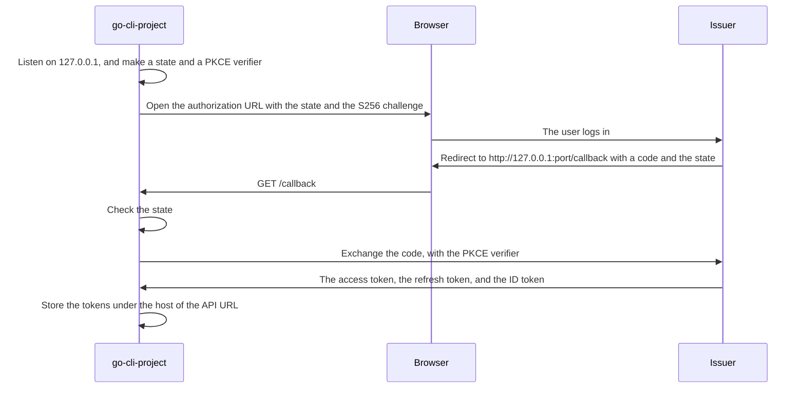
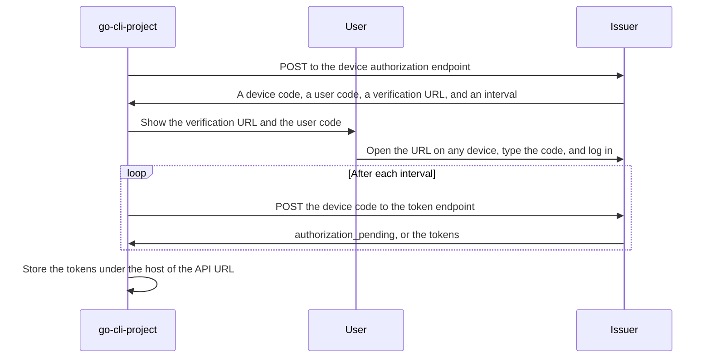

{{- if .Computed.oauth -}}
# How go-cli-project Logs In and Gets Its Access Token
{{- else if .Computed.stored -}}
# How go-cli-project Gets and Stores Its API Key
{{- else -}}
# How go-cli-project Gets Its API Key
{{- end }}

`credential.Resolve` gives the {{ .Computed.label }} that `go-cli-project` sends to its API. It tries a
fixed list of sources and takes the first that gives a value. The code is in `internal/credential`, and
the `auth` commands are in `auth.go`, in the package of the root command.

The section "Authentication" in [README.md](../README.md#authentication) tells a user what to do. This
document tells how the code works, and why.

## Use the {{ .Computed.heading }} in an API Client

Call `credential.Resolve` before each request. Send `found.Value` in the header that the API asks for:

```go
found, err := credential.Resolve(ctx)
if err != nil {
	return err
}
request.Header.Set("Authorization", "Bearer "+found.Value)
```
{{- if .Computed.stored }}

Take the URL of the API from `credential.APIURL()`. The store keeps each {{ .Computed.label }} under the
host of that URL, so the client and the store must use the same URL.
{{- end }}
{{- if .Computed.oauth }}

`Resolve` gets a new access token when the stored one expires, so the client must not keep the value
between requests.
{{- end }}

## The Files

| File | Job |
| --- | --- |
| `credential.go` | `Resolve`, which tries the sources in order. `Credential`, which holds the value and the name of its source. |
| `config.go` | Finds the user config, and reads `credentialCommand` from it. |
| `command.go` | Runs `credentialCommand` through `sh`. |
{{- if .Computed.stored }}
| `api_url.go` | `APIURL` and `APIHost`, from the constant `apiURL` or from `GO_CLI_PROJECT_API_URL`. |
| `store.go` | `Store`, which keeps a value in the OS credential store or in `credentials.json`. |
{{- end }}
{{- if .Computed.oauth }}
| `issuer.go` | The settings of the OAuth client, the discovery of the endpoints, and the revocation of a token. |
| `login.go` | `Login`, with the browser login and the device code login. |
| `tokens.go` | `Tokens`, which the store keeps. The refresh of the tokens, and `Logout`. |
{{- end }}
| `auth.go`, in the package of the root command | The `auth` commands. They call the functions above and print the result. |

## The Order of the Sources

```mermaid
flowchart TD
    resolve["credential.Resolve"] --> variable{"Is GO_CLI_PROJECT_{{ .Computed.variable }} set?"}
    variable -->|"yes"| fromVariable["The value of the variable"]
{{- if .Computed.stored }}
    variable -->|"no"| stored{"Does the store have a {{ .Computed.label }} for the host of the API URL?"}
    stored -->|"yes"| fromStore["{{ if .Computed.oauth }}The stored access token, after a refresh if it expired{{ else }}The stored API key{{ end }}"]
    stored -->|"no"| command{"Does the user config set credentialCommand?"}
{{- else }}
    variable -->|"no"| command{"Does the user config set credentialCommand?"}
{{- end }}
    command -->|"yes"| fromCommand["What the command prints"]
    command -->|"no"| missing["ErrMissing, with the ways to give the {{ .Computed.label }}"]
```

The order has these reasons:

- **The environment variable comes first.** CI and scripts set it for one run. The value for that run must
  replace a value that the user keeps for all runs.
{{- if .Computed.stored }}
- **The stored {{ .Computed.label }} comes before `credentialCommand`.** A user who runs `auth login`
  wants the CLI to use that login. A user who wants `credentialCommand` runs `auth logout` first.
{{- end }}
- **`credentialCommand` comes last.** It is for a user who keeps the {{ .Computed.label }} in a password manager.
  It runs a program each time, so the CLI runs it only when no other source gives a value.

`Credential.Source` names the source: the name of the variable,
{{- if .Computed.stored }}
`the OS credential store`, the path of `credentials.json`,
{{- end }} or `the credentialCommand in <path>`. `auth status` prints it.
No command prints the {{ .Computed.label }} itself{{ if .Computed.oauth }}, except `auth token`{{ end }}.

## The Rules That Keep the {{ .Computed.heading }} Safe

| Rule | Reason |
| --- | --- |
| The CLI has no flag for the {{ .Computed.label }}. | The shell history keeps the value of a flag, and other users of the machine can see it in `ps`. Tests and CI use the environment variable. |
| The CLI reads `credentialCommand` only from the user config. | A file in a repository can come from another person. If that file can set a command, the CLI runs a command of that person on your machine. |
| `credentialCommand` writes its stderr to the terminal. | When a password manager fails, for example because it is locked, the user sees its message. |
{{- if .Computed.stored }}
| The store keeps each {{ .Computed.label }} under the host of the API URL. | If `GO_CLI_PROJECT_API_URL` names another server, the store has no {{ .Computed.label }} for it. So the CLI sends nothing to a server that the {{ .Computed.label }} does not belong to. npm keeps registry tokens in the same way. |
| `credentials.json` has mode `0600`. | Only the user can read it. `Store` writes a temporary file with `os.CreateTemp`, which uses mode `0600`, and then renames it. So another process never reads a part of a file. |
{{- end }}
{{- if .Computed.oauth }}
| The OAuth client has no client secret. | Each user has a copy of the binary, so a CLI cannot keep a secret. PKCE protects the code in place of a secret (RFC 8252). |
| The CLI does not check the signature of the ID token. | The CLI only shows the account to the user, and no decision uses it. The API checks the access token. |
{{- end }}
{{- if .Computed.stored }}

## The Store

`Store` uses the OS credential store through `github.com/zalando/go-keyring`:

- macOS: the Keychain, through `/usr/bin/security`
- Windows: the Credential Manager
- Linux: the Secret Service, through D-Bus

A Linux server or a container often has no Secret Service. So when the OS credential store fails,
`Store` uses `credentials.json`, in the same folder as `config.yaml`. Without the file, `auth login`
does not work on these machines.

| Operation | What `Store` does |
| --- | --- |
| `Set` | It tries the OS credential store first. If that works, it removes the copy for that host from `credentials.json`, so no copy stays on disk. If that fails, it writes the value to `credentials.json`. It returns the place that it used, and `auth login` prints it. |
| `Get` | It reads the OS credential store first, then `credentials.json`. |
| `Delete` | It removes the value from both places. |

`GO_CLI_PROJECT_CREDENTIAL_STORE` selects the places:

| Value | Places |
| --- | --- |
| Empty, or `keyring` | The OS credential store, then `credentials.json` |
| `file` | Only `credentials.json` |
| Any other value | None: `NewStore` returns an error |
{{- if .Computed.oauth }}

The store keeps `Tokens` as JSON: the access token, the refresh token, the token type, the expiry time,
and the account. The OS credential store can refuse large tokens. `go-keyring` accepts about 3 KB on macOS and 2560 bytes on
Windows. If the tokens are larger, `Set` writes them to `credentials.json`, and `auth login` names that file.
{{- end }}
{{- end }}
{{- if .Computed.oauth }}

## Discovery of the Endpoints

`discover` makes the OAuth client from two constants in `issuer.go`: `issuerURL` and `clientID`. An
environment variable replaces each constant. If a constant and its variable are both empty, `discover`
returns an error that names them.

`discover` reads `<issuerURL>/.well-known/openid-configuration` and takes four endpoints from it:
authorization, token, device authorization, and revocation. The document must name the same issuer as
`issuerURL`, as OpenID Connect Discovery says. So a server cannot make the CLI use the endpoints
of another issuer.

The CLI keeps no copy of the endpoints. Each login, refresh, and logout reads the document again, so the
CLI uses a change at the issuer at once.

The CLI sends `client_id` in the form body (`oauth2.AuthStyleInParams`). A public client has no secret
to put in an `Authorization` header.

## Log In in a Browser

`auth login` uses the device code login if the user gives `--device`, or if `BrowserAvailable` returns
false. `BrowserAvailable` returns:

1. True, if `BROWSER` is set
2. False, if `SSH_CONNECTION` or `SSH_TTY` is set
3. On Linux, true only if `DISPLAY` or `WAYLAND_DISPLAY` is set
4. True, in all other cases



Each step has a reason:

| Step | Reason |
| --- | --- |
| The local server listens only on `127.0.0.1`, on a free port. | Other machines cannot send it a code (RFC 8252, section 7.3). |
| The CLI sends an S256 challenge, and later the verifier. | Another program on the machine can see the code, for example in the browser history. Without the verifier, it cannot exchange the code. |
| The CLI checks the state. | The CLI accepts only the answer to its own request. An answer with another state, with an `error`, or with no code stops the login. |
| The CLI prints the URL before it opens the browser. | If the browser does not open, the user can open the URL by hand. |
| The CLI waits 5 minutes for the answer. | If the user closes the browser, the CLI does not wait for ever. |

`openBrowser` starts the program that `BROWSER` names, with the URL as its argument. If `BROWSER` is
empty, it uses `github.com/cli/browser`.

## Log In With a Device Code



`golang.org/x/oauth2` asks the token endpoint again after each interval. It adds 5 seconds to the
interval when the issuer answers `slow_down`, and it stops when the device code expires.

The device code login has a known phishing attack (RFC 8628, section 5.4). An attacker starts a login,
sends the user code to a victim, and gets the tokens when the victim approves. So `auth login` uses the
browser login when the machine has a browser.

## Refresh the Tokens

`Resolve` reads the stored `Tokens`. If the access token expires in less than 10 seconds, `storedTokens`
gets new tokens with the refresh token, and stores them. `golang.org/x/oauth2` sets the 10 seconds.

- If the issuer sends no new refresh token, the CLI keeps the old one.
- If the new tokens have no ID token, the CLI keeps the old account.
- If the stored tokens have no refresh token, or the issuer refuses it, `Resolve` returns an error. The
  error tells the user to run `auth login`.

## Log Out

`Logout` revokes the refresh token at the revocation endpoint of the issuer (RFC 7009), and then removes
the stored tokens. If the tokens have no refresh token, it revokes the access token. If the discovery
document has no revocation endpoint, `Logout` only removes the tokens.

If the revocation fails, `Logout` writes a warning and removes the tokens. The user wants to remove the
tokens from the machine, also when the issuer does not answer.
{{- end }}

## Environment Variables

| Variable | Job |
| --- | --- |
| `GO_CLI_PROJECT_{{ .Computed.variable }}` | Gives the {{ .Computed.label }}. It comes before all other sources. |
{{- if .Computed.stored }}
| `GO_CLI_PROJECT_API_URL` | Replaces the constant `apiURL`, for example for a staging server. |
| `GO_CLI_PROJECT_CREDENTIAL_STORE` | `file` makes the store use only `credentials.json`. |
{{- end }}
{{- if .Computed.oauth }}
| `GO_CLI_PROJECT_OAUTH_ISSUER_URL` | Replaces the constant `issuerURL`. |
| `GO_CLI_PROJECT_OAUTH_CLIENT_ID` | Replaces the constant `clientID`. |
| `BROWSER` | Names the browser for `auth login`. |
{{- end }}
| `XDG_CONFIG_HOME` | Holds the folder `go-cli-project`, with `config.yaml`{{ if .Computed.stored }} and `credentials.json`{{ end }}. If it is empty or not an absolute path, the folder is `~/.config/go-cli-project`. |

## The Tests

The unit tests are in `internal/credential`. Run them with `go test -tags=unit ./internal/credential`.

- Each test calls `isolate`. It sets `XDG_CONFIG_HOME` to a new temporary folder and clears
  `GO_CLI_PROJECT_{{ .Computed.variable }}`.
{{- if .Computed.stored }}
  It also sets `GO_CLI_PROJECT_API_URL`, and sets `GO_CLI_PROJECT_CREDENTIAL_STORE` to `file`. So no test
  reads your config or changes your keychain.
- The tests of `Store` replace the OS credential store with `keyring.MockInit` and
  `keyring.MockInitWithError`. A new test that uses the OS credential store must call one of them first.
  If it does not, it changes your real keychain.
{{- else }}
  So no test reads your config.
{{- end }}
{{- if .Computed.oauth }}
- `fakeIssuer` in `fake_issuer_test.go` is an OAuth issuer on `httptest`. It serves the discovery
  document and the authorization, device, token, and revocation endpoints. It checks the client ID and
  the PKCE verifier. Its fields change its answers, for example `expiresIn`, `refusesRefresh`, and
  `otherState`.
- `browse` does what a browser does: it follows the authorization URL and the redirect back to the CLI.
{{- end }}
<!-- e2e -->

The e2e tests in `e2e/tests/auth.test.ts` run the binary with the same environment variables.
{{- if .Computed.oauth }}
They start a fake issuer in the test process. For the browser login, they set `BROWSER` to a script that
follows the authorization URL with `fetch`.
{{- end }}
<!-- /e2e -->
