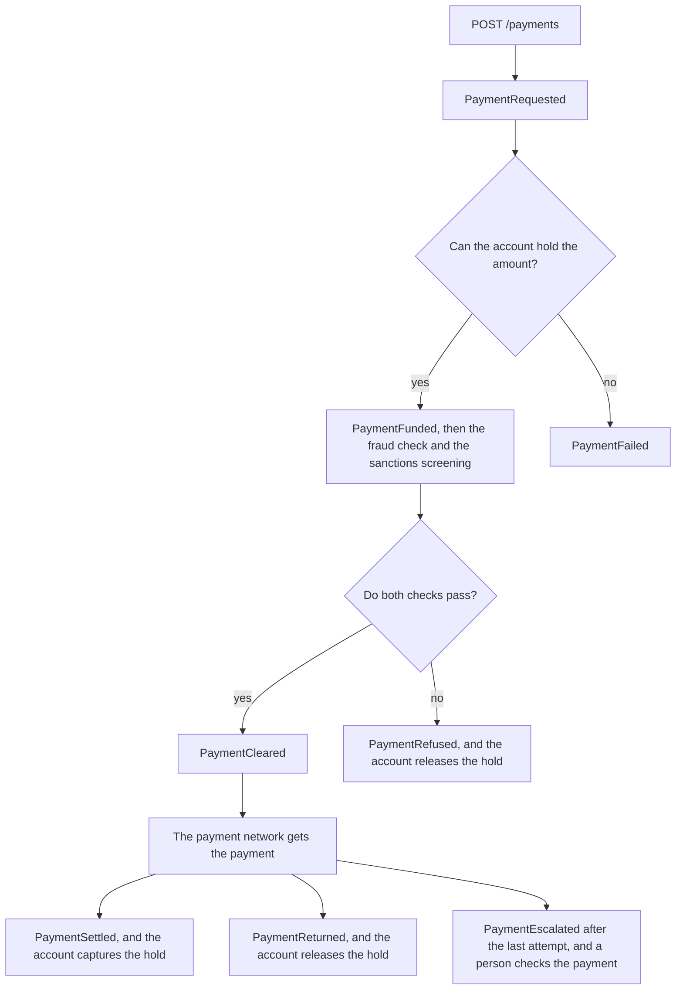
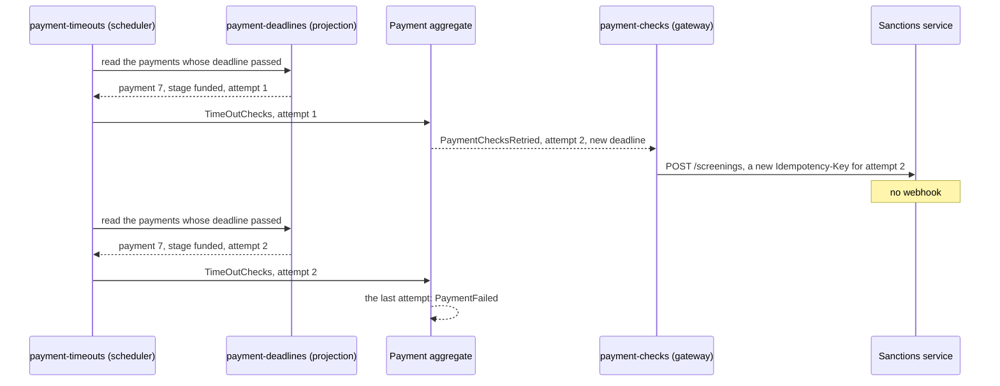
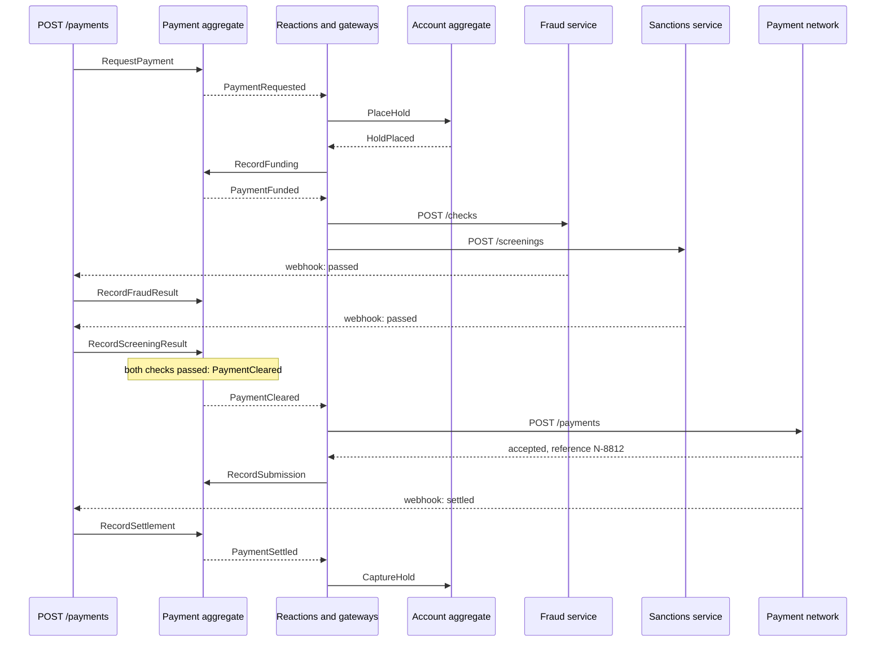
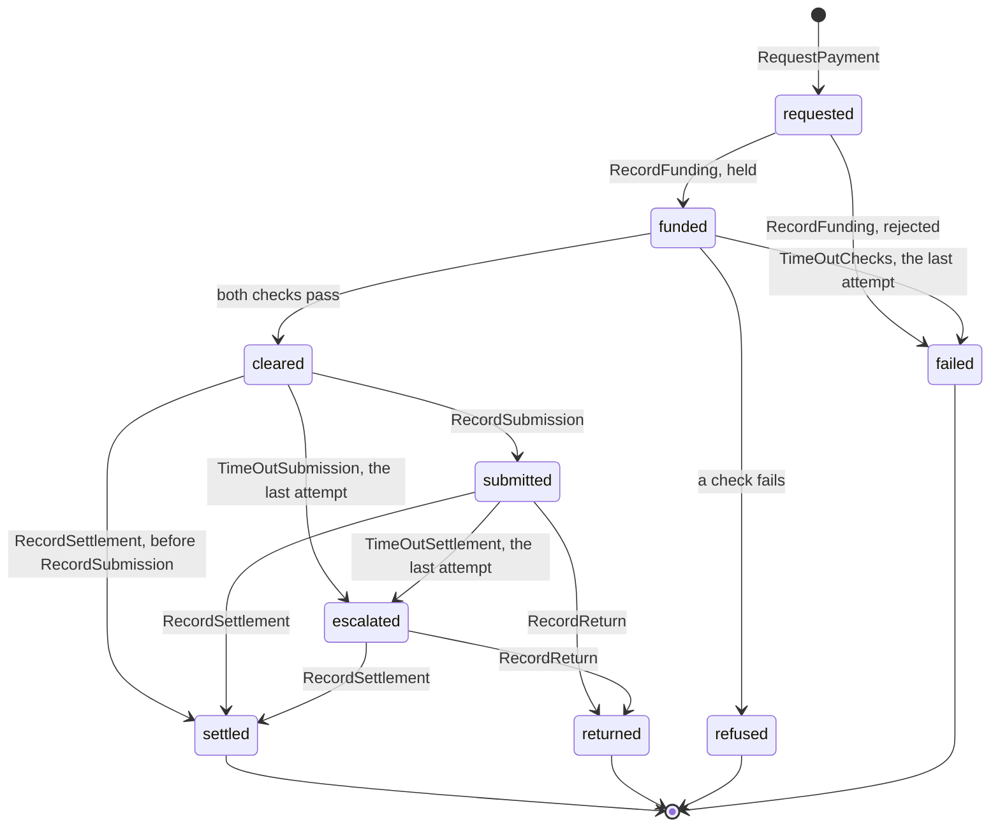

# An Aggregate as the Process Manager of a Payment to Another Bank

A payment to another bank has branches, deadlines, a join of two checks, and an escalation. These features
need a process manager: one component that holds the state of the process and decides each step. In this
example, the payment aggregate is that component. Reactions and gateways carry the messages between the
payment and the other participants, and a scheduler reports each deadline that passes.

[event-model-payment.md](event-model-payment.md) gives the event model, and
[event-subscription.md](event-subscription.md#a-process-manager) tells when a process needs a process
manager.

## The Process

A customer pays an amount from an account to an account at another bank. The bank holds the amount,
checks the payment, sends it to the payment network, and waits for the network to settle it.

The bank holds the amount before it asks for the checks. Then each refusal comes after the hold, and the
release of the hold never arrives before the hold itself.

## Why the Payment Needs a Process Manager

A process needs a process manager when it has one of these features:

| Feature | Where the payment has it |
| --- | --- |
| Branches | The account holds the amount or rejects the hold. The checks pass or fail. The network settles or returns the payment. |
| Deadlines | Each stage has a deadline. The scheduler reports when it passes. |
| Routing from the state of the process | After a deadline passes, the stage and the attempt decide the next step: a retry, a failure or an escalation. |
| A wait for N of M results | The payment clears only when both checks pass. |

A process with none of these features needs no process manager. For example, a transfer between two
accounts in the bank is linear: a debit, then a credit, and a refund when the credit fails. Each account
can react to the events of the other, and no component needs to know the whole process.

## Why the Process Manager Is an Aggregate

A process manager holds the state of the process. Each piece of state of the payment is a business fact,
or a deadline of the payment:

| State | Owner | Why |
| --- | --- | --- |
| Whether the account holds the amount | The payment | For the payment, "the bank holds the money for this payment" is a fact of the payment. The payment does not need the balance. |
| The results of the two checks | The payment | Both results are about this payment, so the payment applies the rule "both checks pass". |
| The stage: requested, funded, cleared, submitted, escalated, and the ends | The payment | It is the state machine of the payment. |
| The deadline of each stage, and the attempt | The payment, as data | The aggregate acts only on a command. A projection lists the payments whose deadline passed, and a stateless scheduler sends a command for each one. |
| The retries of one HTTP call | The gateway | A short retry with backoff is infrastructure. The domain records only the outcome, or a new attempt after a deadline. |

So the state goes into the events of the payment, and the process manager has two parts:

- **The payment aggregate** holds the state and makes each decision. Each input reaches it as a command,
  and each decision leaves it as an event.
- **The reactions and the gateways** carry the messages. They turn the events of the account and the
  answers of the outside systems into commands for the payment. They also turn the decisions of the
  payment into commands for the account and into calls to the outside systems. They make no decision.

The aggregate stays small:

- It refuses a command, or chooses an outcome, from its own history. The rules of the payment list these
  decisions.
- It makes only the decisions that no other aggregate can make. The account decides only whether its
  available balance covers the hold.
- Its state holds only what its rules read, and the account that its events name: the stage, the
  results of the two checks, the attempt, and the account. The deadline and the reference of the network
  are data in the events. The projection and the gateways read them, and no rule of the payment reads
  them.

A process manager can also keep its state in private tables. That form fits a process with technical
steps and no business facts, such as the setup of a tenant through cloud APIs. Each step of the payment
is a business fact, so the payment keeps its state as events.

## The Parts

| Part | Pattern | What it does |
| --- | --- | --- |
| Account | Aggregate, `account-<id>` | Holds, captures and releases an amount for a payment |
| Payment | Aggregate, `payment-<id>` | The process manager: holds the state of one payment and decides each step |
| `payment-funding` | Reaction | `PaymentRequested` → `PlaceHold`. `HoldPlaced` or `HoldRejected` → `RecordFunding`. |
| `payment-holds` | Reaction | `PaymentSettled` → `CaptureHold`. `PaymentRefused`, `PaymentFailed` or `PaymentReturned` → `ReleaseHold`. |
| `payment-checks` | Gateway | `PaymentFunded` or `PaymentChecksRetried` → a request to the fraud service and to the sanctions service |
| `payment-submission` | Gateway | `PaymentCleared` or `PaymentSubmissionRetried` → a request to the payment network, then `RecordSubmission` |
| `payment-status` | Gateway | `PaymentStatusQueried` → a status request to the payment network, then `RecordSettlement` or `RecordReturn` |
| Webhook routes | Translation | `POST /webhooks/fraud-checks` → `RecordFraudResult`. `POST /webhooks/sanctions-screenings` → `RecordScreeningResult`. `POST /webhooks/payment-network` → `RecordSettlement` or `RecordReturn`. |
| `payments` | Projection | The read model of `GET /payments/{id}` |
| `payment-deadlines` | Projection | The todo list: each open payment, its stage, its attempt and its deadline |
| `payment-timeouts` | Scheduler | Each second, reads the todo list and sends a command for each passed deadline. Its name differs from the projection, because `catchup` holds a lock on the name of each worker. |

The gateways read the amount and the creditor from the first event in the stream of the payment,
because the aggregate keeps only what its rules read. The webhook routes are protected routes of the
API, so an outside system sends the bearer token of the API.

## Commands and Events

### Account

| Command | Events | Refused when |
| --- | --- | --- |
| `PlaceHold` | `HoldPlaced`, or `HoldRejected` when the available balance is too small or the account is closed | `AccountExists` |
| `ReleaseHold` | `HoldReleased` | `AccountExists` |
| `CaptureHold` | `HoldCaptured`: the amount leaves the account | `AccountExists`, `HoldExists` |

- The available balance is the balance minus the holds. A withdrawal also checks the available balance.
- The balance in `account_balances` changes only when the account captures a hold.
- Each hold has the ID of its payment. A repeated command for the same payment records nothing, and
  `ReleaseHold` records nothing for a payment with no hold.

### Payment

| Command | Sender | Events |
| --- | --- | --- |
| `RequestPayment` | API | `PaymentRequested` |
| `RecordFunding` | `payment-funding` | `PaymentFunded`, with the deadline of the checks. Or `PaymentFailed`. |
| `RecordFraudResult` | Webhook | `FraudCheckPassed` or `FraudCheckFailed`, then `PaymentCleared` or `PaymentRefused` |
| `RecordScreeningResult` | Webhook | `SanctionsScreeningPassed` or `SanctionsScreeningFailed`, then `PaymentCleared` or `PaymentRefused` |
| `RecordSubmission` | `payment-submission` | `PaymentSubmitted`, with the reference of the network and the deadline of the settlement |
| `RecordSettlement` | Webhook, `payment-status` | `PaymentSettled` |
| `RecordReturn` | Webhook, `payment-status` | `PaymentReturned`, with the reason from the other bank |
| `TimeOutChecks` | `payment-timeouts` | `PaymentChecksRetried`, with a new deadline. After the last attempt, `PaymentFailed`. |
| `TimeOutSubmission` | `payment-timeouts` | `PaymentSubmissionRetried`, with a new deadline. After the last attempt, `PaymentEscalated`. |
| `TimeOutSettlement` | `payment-timeouts` | `PaymentStatusQueried`, with a new deadline. After the last attempt, `PaymentEscalated`. |

Rules of the payment:

| Rule | Statement |
| --- | --- |
| `RequestedOnce` | A payment is requested once |
| `PositiveAmount` | An amount is more than 0 |
| `AccountExists` | The account of the payment exists. The handler of `RequestPayment` checks it, because the account refuses a hold on an unknown account, and a refusal records no event. The payment then waits forever. |
| `EndsOnce` | A payment ends once: settled, returned, refused or failed |
| `ResultOnce` | Each check records one result. A result that arrives again records nothing. |
| `StageMatches` | A command acts only in its stage, and in other stages it records nothing. For example, `TimeOutChecks` acts only while the checks wait, and only for the attempt that is due. |

Each stage waits 10 seconds by default, and a payment asks 3 times for one stage before it fails or
escalates. With these values, the payment with the IBAN that ends in `4444` escalates after about 30
seconds.
The payment records `PaymentCleared` when both checks passed, and `PaymentRefused` at the first check
that fails. After the network can have the payment, the payment never fails by itself: it escalates to a
person. The network can settle a payment late, and a released hold then lets the customer spend money
that left the bank. So an escalated payment still waits for the network, and a later settlement or
return ends it.

`RecordSettlement` and `RecordReturn` act from the time the payment clears. The network can settle a
payment before `payment-submission` records the reference of the network.

## Time

- The scheduler has no state. It reads the todo list and sends a command with a fixed ID, from the
  payment ID, the stage and the attempt. A repeated tick sends the same command, and the bus skips it.
- The payment decides what a passed deadline means. The scheduler only reports that the time passed.
- A command for an old attempt records nothing, because the rule `StageMatches` checks the attempt.

## A Payment That Settles

The stages of the payment aggregate:

## How the Example Stays Correct

Each step is safe to run again:

- **Commands** have a fixed ID: from `dispatch.CommandFor` in a reaction, and from the payment, the
  stage and the attempt in the scheduler. The store records each command once.
- **Calls to outside systems** carry an `Idempotency-Key`. A check gets a new key for each attempt, so a
  check service that lost a request runs the check again. The submission keeps one key for all
  attempts, so the network never takes the payment twice. The fake outside systems give the same
  answer to a repeated key.
- **A gateway that fails** after its short retries logs the error and does not stop its consumer. The
  deadline of the payment then asks again. So one outside system that is down does not stop the other
  consumers.
- **The scheduler** runs under `lock.Postgres.Hold`, as each consumer does, so one process sends its
  commands.

## The Fake Outside Systems

One small service, `cmd/fakeservices`, fakes the three outside systems. It accepts a request, answers
`202 Accepted`, and calls the webhook in the request after a short delay. It decides once for each
`Idempotency-Key`, so a repeated request gets the same answer and no second webhook. It also answers
the status request of the network, `GET /network/payments/{reference}`. The input of the payment
selects the path:

| Input | Path |
| --- | --- |
| Amount above 10000 | The fraud check fails |
| Creditor IBAN that ends in `0000` | The sanctions screening fails |
| Creditor IBAN that ends in `1111` | The sanctions service does not answer: the checks time out |
| Creditor IBAN that ends in `2222` | The other bank returns the payment |
| Creditor IBAN that ends in `3333` | The settlement webhook does not arrive, and the status request answers `settled` |
| Creditor IBAN that ends in `4444` | The network never settles the payment, and the status request answers `pending`. The payment escalates. |
| Any other input | The payment settles |

## What the Example Shows

| Pattern | Where |
| --- | --- |
| Process manager | The payment aggregate, with its reactions and gateways |
| Command | `POST /payments` → `RequestPayment` |
| View | `GET /payments/{id}`, and the todo list of the scheduler |
| Automation | The reactions and the gateways |
| Translation | The webhook routes |
| Scheduler | `payment-timeouts`, with the todo list `payment-deadlines` |

It also shows a join of two checks inside one aggregate, a compensation that releases the hold, and an
escalation that keeps the hold after the network can have the payment.
